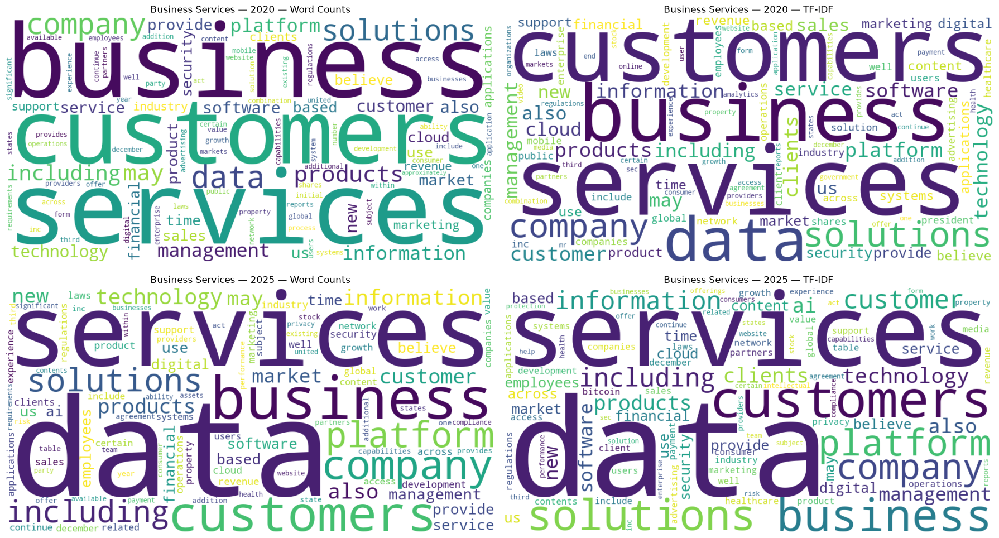

# Business Services Firm Analysis

**Python and natural language processing · UBC Sauder MBAN · BAIT 508 · Group 26**

How did Business Services firms describe their operations in 2020 and 2025, and what can those disclosures tell us about Microsoft’s peers? This project combines a 32-year financial panel with the business descriptions in Form 10-K Item 1. The team uses text similarity to select five companies for a 2020 financial comparison and examines how margins and asset turnover contributed to the subsequent change in Microsoft’s return on assets.

[Explore the notebook](analysis.ipynb) · [Read the team report](report/final-report.pdf)



*Figure from the project notebook. “Services” leads the 2020 rankings, while “data” leads both 2025 rankings.*

## Key findings

- **The sector panel changes substantially over time.** The SIC 73 sample contains 30,610 distinct firm-years and 3,273 firms from 1994 to 2025. Only 64 firms appear in all 32 years, so annual averages reflect both financial changes and changes in the firms represented.
- **Data and AI language gained prominence.** “Data” ranked first in 2025 by word counts and aggregated TF-IDF. “AI” had the largest increase in share under both measures. Its share of counted terms rose from about 0.033% in 2020 to 0.282% in 2025. The disclosure samples contain 482 and 510 matched firms, respectively, with 306 in both years.
- **Microsoft led its selected peers on ROA, then saw turnover fall.** Its 2020 return on assets was 14.70%, compared with a median of 6.57% among five peers selected by filing similarity. Microsoft’s asset turnover declined from 0.543 in 2022 to 0.455 in 2025 as its net margin remained close to 36%. The team proposed staging new cloud and AI capacity investment against demonstrated demand and expected incremental returns.

## Data and approach

| Stage | What the notebook does |
| --- | --- |
| Financial panel | Filters firm-years to Business Services using SIC major group 73. Counts distinct `gvkey`–`fyear` pairs and summarizes prices, sales and ROA. [SIC 73 classification](https://www.osha.gov/data/sic-manual/major-group-73) |
| Filing text | Cleans Item 1 business descriptions and joins them to same-year financial records by `gvkey`. Uses word counts and TF-IDF to compare disclosure language. [SEC guide to Form 10-K](https://www.sec.gov/files/reada10k.pdf) |
| Word embeddings | Trains separate NumPy skip-gram Word2Vec models with negative sampling on each year’s full filing corpus and compares nearest neighbours for selected terms. |
| Microsoft case study | Uses cosine similarity of 2020 TF-IDF document vectors to select F5, Salesforce, Open Text, VMware and Progress Software. Compares revenue and ROA, then decomposes Microsoft’s ROA into net margin and asset turnover. |

## View or rerun

**On GitHub.** Open the [Jupyter notebook](analysis.ipynb) to browse the code and saved outputs, or open the [PDF report](report/final-report.pdf) for the full write-up.

**Locally.** Rerunning requires authorized copies of the four original course CSVs. The portfolio package contains the analysis and selected outputs. Use Python 3.14, the version series used for the saved notebook. From the repository folder, install the dependencies and launch JupyterLab.

```sh
python -m pip install -r requirements.txt
python -m nltk.downloader stopwords
jupyter lab
```

Place `major_groups.csv`, `public_firms.csv`, `2020_10K_item1_full.csv` and `2025_10K_item1_full.csv` in a `data/` folder next to `analysis.ipynb`. Open the notebook from JupyterLab and run the cells in order. Training the two Word2Vec models can take substantially longer than the other sections.

## Limitations

- **Coverage and document quality.** The financial panel is unbalanced. The matched filing samples also differ by year, and some records show discrepancies between the displayed firm and filing text. Aggregate shifts mix changes in wording with changes in sample composition. Original filings can help verify firm matches. [SEC EDGAR](https://www.sec.gov/edgar/search/)
- **Year-specific models.** The two TF-IDF models use different document frequencies. The Word2Vec models were trained independently, so the comparison uses nearest-neighbour lists and avoids direct comparisons of embedding coordinates.
- **Financial interpretation.** Revenue uses the course data’s source units. Sector sales share is relative to the SIC 73 sample. Filing similarity is a proxy for shared disclosure language, and consolidated ROA and asset turnover cannot isolate the returns on cloud or AI investment.

## Repository structure

```text
README.md                        Project overview and viewing instructions
analysis.ipynb                   Python notebook with selected saved results
requirements.txt                 Python dependencies for a local rerun
assets/disclosure-keywords.png   Word clouds from the notebook
report/final-report.pdf          Portfolio copy of the team report
```

## Team

**Jinsong Liang and Ioannis Polyzopoulos** completed this project as Group 26 for BAIT 508 in the UBC Sauder Master of Business Analytics program. The portfolio report retains the team’s AI-use disclosure and omits student IDs, emails and chat links.
